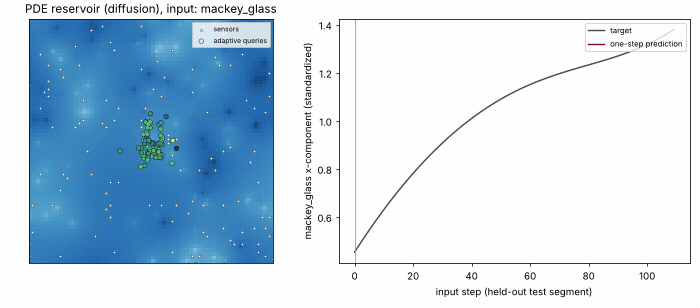
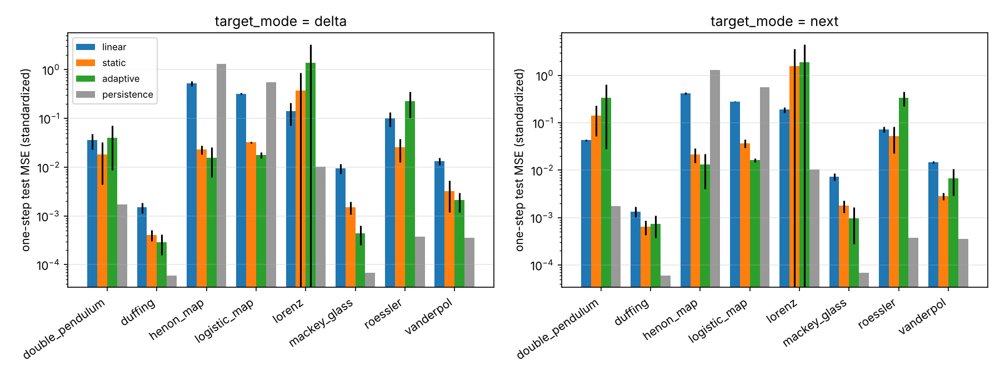

# ASAERC: Adaptive-Sensing Attention-Enhanced Reservoir Computing

[](https://github.com/fekoester/ASAERC/actions/workflows/ci.yml)
[](LICENSE)

A research codebase for a **2D PDE reservoir**: a diffusion or wave field driven by time-series inputs. It compares
three ways of reading the field out:

| readout | what it sees | trained parameters |
|---|---|---|
| **linear** | fixed sensors | one linear layer |
| **static attention (AERC)** | field values at fixed random query points, weighted by an MLP of the sensor values | MLP |
| **adaptive sensing** | the MLP also outputs **where** to look: query positions move with the state | MLP |

<p align="center">
  
  <br>
  <em>A diffusion reservoir driven by the Mackey-Glass series on the held-out test segment. White dots are the fixed sensors;
  coloured dots are the adaptive readout's query positions, coloured by their output weight.</em>
</p>

## Quickstart

```bash
pip install -e ".[dev]"

python scripts/make_raw_data.py --out_dir raw_data            # 8 chaotic systems and maps
python scripts/preprocess_data.py --raw_dir raw_data --out_dir processed_data
python scripts/run_experiment.py --config configs/example.yaml --device cuda
python scripts/plot_run.py --run_dir runs/run_seed0           # loss, predictions, fields
```

Each run writes `runs/run_seed<seed>/` with these files:
- `config.json`
- `metrics.json`: train/test MSE, per-system test MSE, a persistence baseline and the closed-loop valid prediction time
- `readout.pt` and `pde.pt`
- `correlations.npz`: correlation matrices of what the readout looks at
- debug bundles for plotting

Compare all readouts on the same reservoir and data:

```bash
python scripts/compare_readouts.py --config configs/example.yaml --seeds 0,1,2 --target-modes next,delta
```

Animate a trained run (field and query points):

```bash
python scripts/animate_field.py --run_dir runs/run_seed0 --system mackey_glass --out field.gif
```

## Results

`results/readout_comparison/` holds the CPU run that the summary below is based on. Its settings:
- 8 systems, 2,000 steps each, 80/20 split
- a 64×64 diffusion reservoir
- 64 query points
- 40 epochs
- 3 seeds

Settings are in `config.yaml`, and the raw numbers are in `results.csv` and `summary.md`. Errors are one-step test
MSE on standardized data, shown as the mean ± std over seeds.



What the results show:

- **On the maps, attention readouts clearly win.** Adaptive sensing has the lowest error:
  - Hénon: 0.013 ± 0.011, compared with 0.42 for the linear readout and 1.31 for persistence.
  - Logistic map: 0.016, compared with 0.28 (linear) and 0.56 (persistence).

  Here consecutive values really differ, and the field-sampling readouts capture the non-linearity that a linear map
  over sensors cannot.
- **On the smooth ODEs, nothing beats persistence** (systems sampled at `dt = 0.01`: Lorenz, Rössler, Duffing, Van der
  Pol, Mackey-Glass, double pendulum). Consecutive samples are almost identical, so "next = current" scores an MSE of
  6e-5–1e-2, below every trained readout. This holds for `target_mode: delta` too. To test these systems meaningfully,
  generate them with a larger step (`make_raw_data.py --dt`) or predict further ahead.
- **Attention training is not yet robust.** On Lorenz and Rössler, some seeds diverge (Lorenz, adaptive, delta: 1.4 ± 2.3)
  while others reach about 0.06. The training/test gap is also large (train MSE 0.003 vs. test 0.09 in the GIF run). A
  lower learning rate than the default `lr: 0.01` is the first thing to try.
- **Adaptive queries collapse into one cluster** without repulsion (see the GIF). `repulsion_coef > 0` spreads them out.

## Features

- **PDE modes**: `diffusion`, `diffusion_leaky` and `wave`, with periodic or Dirichlet boundaries and constant, impulse
  or periodic forcing.
- **Stability check**: an explicit-scheme stability number (diffusion: `2·D·dt·(1/dx²+1/dy²) ≤ 1`; wave: CFL). The
  reservoir warns when it is exceeded, or raises with `strict_stability=True`.
- **Batched simulation**: equal-length series run as one batch of independent fields
  (`simulate_pde_for_files`), with results identical to running them one at a time.
- **Seeded reservoirs**: `PDE2DReservoir(seed=...)` uses a private random generator; without a seed, NumPy's global
  generator is used, as before.
- **Target modes**: `target_mode: next` predicts `y_{t+1}`; `delta` predicts `y_{t+1} − x_t`.
- **Closed-loop forecasting**: `asaerc.forecast.closed_loop_forecast` and `valid_prediction_time` report how many steps
  an autonomous forecast stays within a normalized error of 0.4.
- **Correlation diagnostics**: correlations of the sampled values, weighted values and weights over time
  (`asaerc.diagnostics.compute_correlation_mats`).
- **Leak-free preprocessing**: each series is standardized with statistics from its training part only. Use
  `--train_frac 1` for the old whole-file behaviour.

## Performance

| | v0.1 | v0.2 |
|---|---:|---:|
| simulate 8 series × 200 steps, 100×100 grid, 25 micro-steps (2 CPU cores) | 3.77 s | **1.48 s** |

The speedup comes from a `torch.roll` / pad-and-slice Laplacian instead of pad + conv2d per micro-step, and from
batching the series. The outputs match the old solver to about 1e-9. On a GPU, batching helps much more.

## Repository layout

```text
src/asaerc/reservoir/pde.py      PDE reservoir, Laplacian, stability check
src/asaerc/readouts/             linear / static / adaptive attention readout
src/asaerc/simulation.py         (batched) reservoir simulation
src/asaerc/experiment.py         simulate once, train/evaluate/forecast several readouts
src/asaerc/forecast.py           closed-loop forecast, valid prediction time
src/asaerc/diagnostics/corr.py   correlation diagnostics
scripts/                         data generation, preprocessing, experiments, comparison, plots, animation
results/                         tracked benchmark results
tests/                           pytest suite (CPU, a few seconds)
```

## Development

```bash
pip install -e ".[dev]"
ruff check . && ruff format --check .
pytest -q
```

## License

MIT (see [LICENSE](LICENSE)).
